# NeighLoop 数据库 ER 图

提交材料使用 [完整 PNG](ER.png) 或 [完整 SVG](ER.svg)，Mermaid 源码见 [ER.mmd](ER.mmd)。录屏最后 10 秒可使用字更大的 [核心链路简图](ER_OVERVIEW.png)，它只保留社区、物品、需求讨论、预约私聊和成交关系。

## 关键约束

- `community_members(community_id, user_id)` 唯一；用户只有加入社区后才能访问该社区的物品和统计。
- `interests(item_id, user_id)`、`item_views(item_id, user_id)` 唯一。
- `reservations` 使用部分唯一索引，限制同一物品最多一条 `CONFIRMED` 预约，以及同一买家对同一物品最多一条 `PENDING` 预约。
- `transactions.item_id` 唯一；完成预约与成交记录在同一数据库事务中写入。
- `item_events` 用统一写入函数保存物品生命周期；`metadata` 为可空 JSON，不保存领取码。
- `reservations` 新增 `handover_status`、`arrived_at`、`delay_minutes`、`wait_until`，分别支持出发／到达／晚到与卖家延长等待。
- `private_messages` 以物品、发送者、接收者组成双方会话；`is_ai` 明确标记助手回复，`read_at` 记录已读。对话只对参与的双方开放，预约和交接状态消息也保存在这里。
- `needs` 属于社区，`need_replies` 属于某条需求；回复可选附上回复者本人当前在架的物品，`need_matches` 单独保存规则匹配结果。
- `user_presence.last_seen_at` 支持发布者离线判断；`user_preferences` 与已完成的 `transactions` 类别共同影响推荐排序。普通浏览记录不会自动成为推荐偏好。
- `items.image_key` 用于读取上传图片或演示图集，并非指向 `uploaded_images` 的数据库外键；演示图中的关系线只画实际外键。
- `UNCONFIRMED` 根据 `last_confirmed_at` 超过 72 小时实时计算，不作为数据库中单独的持久状态。
